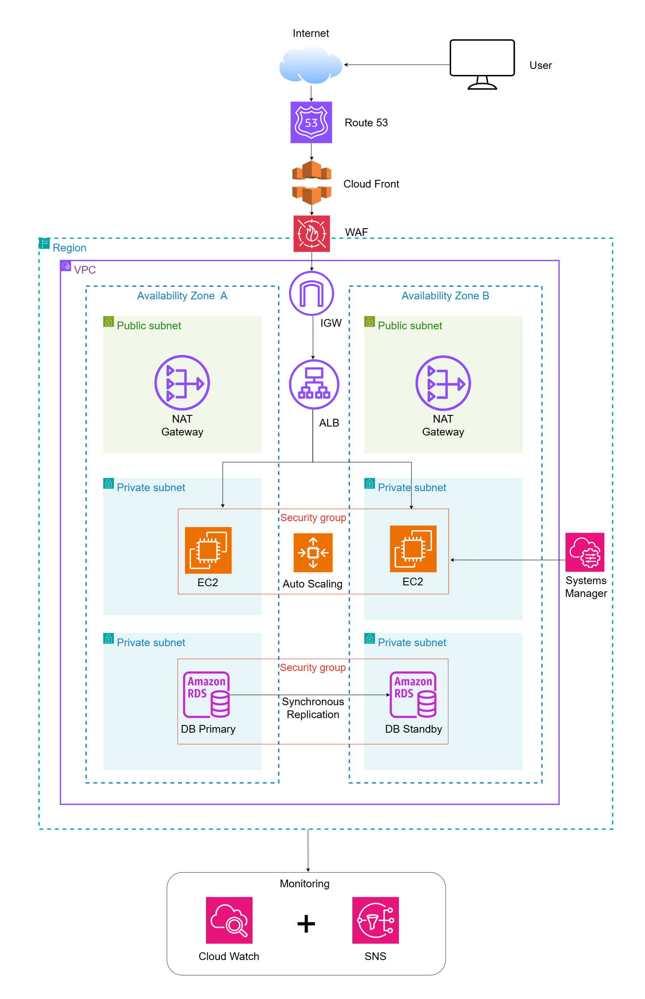

## Solution Overview

This project implements a production-grade, highly available web application on AWS, built entirely with EC2 instances inside a purpose-designed VPC.

The architecture spans two Availability Zones to eliminate single points of failure and uses a layered defense-in-depth approach at the network edge, the compute tier, and the data tier.

- **Global entry point:** Amazon Route 53 resolves DNS for the application and performs health checks against the origin, while Amazon CloudFront caches static assets at edge locations to reduce latency for end users worldwide.
- **Edge security:** AWS WAF is attached at the edge and inspects every request against a managed rule set covering the OWASP Top 10, blocking common web exploits before they reach the application.
- **Load balancing and compute:** An Application Load Balancer (ALB) performs Layer 7 routing and distributes traffic across two Availability Zones to EC2 instances running in an Auto Scaling Group (ASG). Instances are launched from a standardized Launch Template and scale automatically using target tracking policies based on real-time demand.
- **Network isolation:** All compute and database resources live in private subnets with no direct internet exposure. Public subnets host only NAT Gateways (one per AZ) for controlled outbound access, and Security Groups plus Network ACLs enforce least-privilege access between tiers.
- **Secure administrative access:** AWS Systems Manager Session Manager provides shell access to EC2 instances without a bastion host, an open SSH port, or a public IP address.
- **Data tier:** Amazon RDS runs in Multi-AZ mode (MySQL/PostgreSQL) with a primary instance and a synchronously replicated standby in the second Availability Zone, enabling automated failover with minimal downtime.
- **Observability:** Amazon CloudWatch collects metrics, logs, and dashboards across the stack, and Amazon SNS delivers alarm notifications so operational issues are surfaced immediately.

Together, these components deliver a resilient, self-healing, and secure architecture that can absorb instance failures, Availability Zone outages, and common web attacks while scaling automatically with traffic.

## Architecture Diagram

**Request flow:**

1. A user's request first resolves through **Route 53**, which also runs health checks against the application.
2. Static content is served from the **CloudFront** edge cache; dynamic requests continue toward the application.
3. **AWS WAF** filters malicious traffic against OWASP Top 10 rules before it reaches the load balancer.
4. Traffic enters the **VPC** through the **Internet Gateway** and is distributed by the **Application Load Balancer** across both Availability Zones.
5. The **ALB** forwards requests to **EC2 instances** running in an **Auto Scaling Group** inside private subnets, which scale in and out based on target tracking policies.
6. **NAT Gateways** in the public subnets provide outbound-only internet access (e.g., for OS/package updates) for the private instances.
7. Application instances read/write to the **Multi-AZ RDS** database; the primary instance in Availability Zone A synchronously replicates to the standby in Availability Zone B for automated failover.
8. Administrators access instances securely via **Systems Manager Session Manager**, with no bastion host or open inbound ports required.
9. **CloudWatch** continuously collects metrics and logs from all layers, triggering **SNS** notifications on alarm conditions for proactive incident response.
